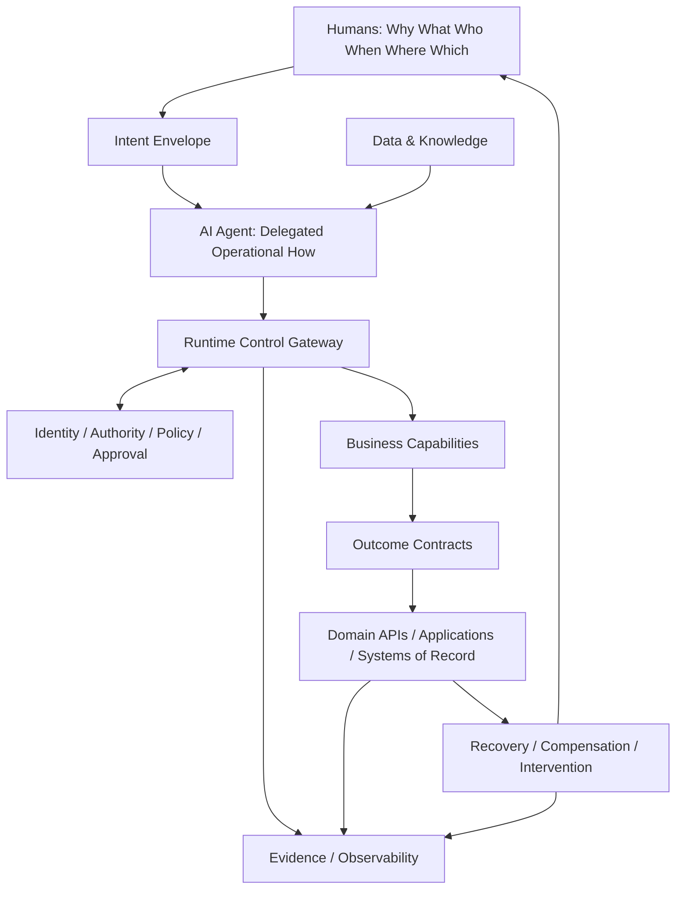
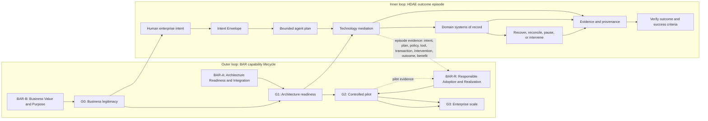

# HDAE Reference Architecture

Cross-cutting technology enablement: identity, authorization, policy, integration,
security, observability, evidence, recovery, data governance, agent/model lifecycle.
## BAR-Governed HDAE Reference Architecture

This reference architecture implements the revised BAR-HDAE dual-loop model. BAR governs whether, where, and to what extent an AI capability should be adopted and scaled. HDAE governs how one authorized human outcome episode is planned and executed. Runtime evidence flows back to BAR lifecycle decisions.

## Responsibility allocation

- **Human enterprise intent:** defines why, what, who, when, where, which, authority, constraints, and success evidence.
- **Delegated operational agency:** determines the operational how inside explicit permission, prohibition, threshold, expiry, and revocation boundaries.
- **Technology mediation:** authenticates principal, workload, and tool; validates intent and contracts; independently evaluates policy; obtains required human approval; orchestrates durable actions; records evidence; verifies postconditions.
- **Domain execution:** authoritative applications and systems of record preserve business invariants and transaction correctness.
- **Evidence bridge:** episode evidence informs BAR-R adoption, remediation, autonomy, scale, and retirement decisions.

## BAR evidence gates

| Gate | Decision | Minimum evidence |
| --- | --- | --- |
| G0 | Business legitimacy | Problem, accountable owner, baseline, target benefit, affected parties, AI-versus-alternative rationale |
| G1 | Architecture readiness | Authoritative data, capabilities, contracts, identity, integration, NFRs, resilience, observability, lifecycle cost |
| G2 | Controlled pilot | Restricted authority, policy compliance, trace completeness, tested recovery, adoption, KPI evidence |
| G3 | Enterprise scale | Sustained value, readiness, responsible adoption, reusable controls, continuous assurance |

## Seven HDAE implementation phases

1. Scope outcome episode.
2. Model Intent Envelope.
3. Map capabilities and contracts.
4. Design delegation and autonomy.
5. Assemble agent toolchain.
6. Engineer integrity and evidence.
7. Validate, learn, and scale.

The 12 toolkit artifacts map to these phases in the process builder. The framework is conceptual and has not been empirically validated; organizations must tailor thresholds and evidence to their context.
